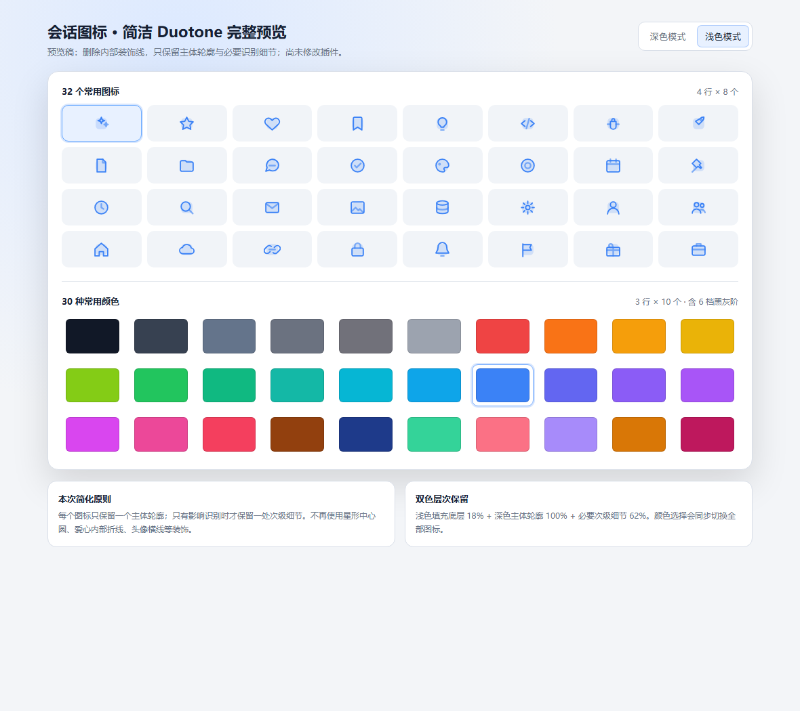

# dsh-conversation-icons

适用于 **DSH 0.2.1** 系列的会话图标插件。它允许用户或模型为每个会话选择独立的 SVG 图标和颜色；配置保存在当前浏览器的 `localStorage`，不会写入会话正文。



> 产品预览：31 个双色常用图标与 18 种高辨识度颜色；实际界面会跟随 DSH 主题与布局。

## 功能

- 会话行前方显示已设置的彩色 SVG 图标；未设置时可从会话 `…` 菜单进入选择器。
- 会话菜单提供 **设置图标 / 切换图标** 操作。
- 中文选择器内置 31 个双色层次 SVG 图标与 18 种高辨识度颜色。
- 使用原生按钮、`radiogroup` / `radio` 语义与中文 `aria-label`，支持键盘操作。
- **恢复默认** 会删除该会话的本地配置。
- 提供工具 `dsh_session_icons_assign`，模型可按会话 ID、图标 ID、颜色 ID 请求客户端设置图标。
- 跨标签页监听 `storage` 事件；模型工具请求通过插件事件通道下发。

## 官方扩展点

客户端只使用 DSH 公共槽位：

- `sidebar.session.row.leading`
- `sidebar.workspaces.session.menu.item`
- `shell.overlay`

界面使用 React 和 `@deepseek-ai/dsh-client-ui-primitives` 的 `Modal`、`Button`、`MenuItemButton`。

## 开发与验证

```sh
npm run check
npm pack --dry-run
```

`npm run check` 会重新生成 `lib/`，执行 Node 单元测试与包结构自检。

## 安装

```sh
dsh plugin --profile web add dsh-conversation-icons
```

安装或替换构建产物后，如插件管理器提示 restart-required，请完整重启对应 DSH Web profile。

## 数据格式

localStorage 键：`dsh-session-icons:v1`

```json
{
  "session-id": { "icon": "star", "color": "blue" }
}
```

损坏数据、未知图标或未知颜色会被安全忽略。配置不会自动跨浏览器、跨设备或跨 origin 同步。

## 许可

MIT
